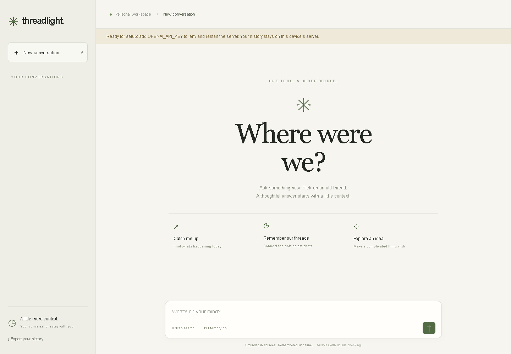

# Threadlight

A personal chat agent with exactly **one tool: web search**. Fast streamed replies, linked sources, and persistent memory of what you asked and when.

## Run locally

Requires Python 3.11+ and an OpenAI API key with Responses API and web search access. API usage is billed by OpenAI; no key is included. ChatGPT subscriptions do not include API usage.

```bash
python -m venv .venv
# Windows PowerShell
.venv\Scripts\Activate.ps1
# macOS / Linux: source .venv/bin/activate
python -m pip install -r requirements.lock
cp .env.example .env
```

Set `OPENAI_API_KEY` in `.env`, then:

```bash
python app.py
```

Open **http://127.0.0.1:8000**. No Node build or separate database service is needed. Keep the browser cookie to retain access to your conversations across restarts.



## What it does

- Streams text immediately as the model generates it; shows when web search runs.
- Offers only OpenAI's `web_search` tool. Memory and timestamp injection are application logic, not model-callable tools.
- Lets the model search when facts need checking and skip it for simple writing and personal recall.
- Displays clickable sources supplied by the model API's citation annotations.
- Stores questions, answers, sources, and server-assigned UTC timestamps in SQLite.
- Carries recent conversation context and retrieves relevant timestamped questions across chats.
- Provides multiple conversations, JSON history export, and deletion that removes associated memories.
- Has a responsive, keyboard-accessible interface, safe text rendering, and reduced-motion support.
- Reports missing credentials, upstream failures, and interrupted replies honestly. No fake search results or demo answers.

Try: “I prefer Python for backend development.” Then start another chat and ask: “What language do I prefer, and when did I tell you?” Also try: “What happened in technology today? Cite original sources.”

## Configuration

| Variable | Default | Purpose |
| --- | --- | --- |
| `OPENAI_API_KEY` | none | Server-only API credential |
| `OPENAI_MODEL` | `gpt-4.1-mini` | Responses-compatible model supporting web search |
| `PORT` | `8000` | Local HTTP port |
| `DATABASE_PATH` | `data/threadlight.db` | SQLite persistence path |

The default model prioritizes latency and cost. Change it to a stronger search-compatible model when deeper reasoning matters more than speed. No accuracy or latency benchmark is claimed.

## Tests

```bash
python -m unittest discover -s tests -v
```

Tests mock the provider stream and need no API key. They cover streaming persistence, the one-tool contract, citations, cross-chat recall, timestamps, browser-session isolation, validation, deletion, missing credentials, and interrupted replies. They do not measure model factual accuracy. To verify live behavior, configure a real key and run the example questions above; check both cited sources and remembered timestamps.

Optional browser checks (start the server first):

```bash
python -m pip install -r requirements-dev.txt
python -m playwright install chromium
python tests/browser_smoke.py
```

This checks setup errors, a mocked response stream, inline source links, mobile overflow, and JavaScript errors. To use an installed Edge or Chrome instead of downloading Chromium, set `BROWSER_CHANNEL=msedge` or `BROWSER_CHANNEL=chrome`. The setup-error check assumes no API key is configured.

## Design and deployment

See [design.md](design.md) for architecture, tradeoffs, threat model, evaluation, and limits.

This is a **local personal application**, not an authenticated public SaaS. It binds to localhost. Before internet deployment, add account authentication, HTTPS, rate limits, request budgets, a production WSGI server, and shared coordination for multiple workers. For persistence in containers, mount the database directory to a durable volume. Back up the SQLite database using SQLite's backup API.

Your chat content and selected history are sent to OpenAI to generate replies. Search queries can be sent to the web-search service. SQLite is local and unencrypted. Deletion removes active database rows, not independent backups or previously sent provider data. `.env` and `data/` are ignored by Git.

## Provider reference

Built against the official [Responses API](https://developers.openai.com/api/reference/resources/responses) and [web search guide](https://developers.openai.com/api/docs/guides/tools-web-search). There is no separate search API key or second model tool.
